# Learn the visual taste: 12 illustrated examples

**Start with the pictures.** Numbered boxes identify the exact feature being
judged. Each page says what failed or worked, why, and what to do differently.
Click a picture for its full-size version.

The retained starting file is **Factory Orbs / CUSTOM-ORBS**. This guide adds
teaching material; it does not change the level or restart the discarded art
experiment. "Good" identifies a specific retained component, not approval of
every object in the same screenshot.

| Requested category | Pictures | What to learn |
| --- | --- | --- |
| [What is bad](#what-is-bad) | 01–02 | Cube clutter and the unfinished white exit |
| [What is good](#what-is-good) | 03–04 | Fitted ship structure; wave and early robot identity |
| [Bad techniques](#bad-techniques) | 05–06 | Filling empty space; scaling up repeated fire |
| [Good techniques](#good-techniques) | 07–08 | Steel skins and custom pressure-switch orbs |
| [What I learned](#what-i-learned) | 09–10 | Component-level feedback, group isolation and editor layers |
| [Things for later](#things-for-later) | 11–12 | Purposeful assemblies and atmosphere tested in motion |

**Evidence matters:** owner feedback is paraphrased; the numbered diagnoses are
my interpretation. Editor captures and approximate atlas renders are labeled.
The final two pages are **unbuilt diagrams**, not screenshots of completed work.
Cyan selection lines in editor captures are not level decoration. Historical
views with different cameras are component comparisons, not matched before/after
tests. Original pixels are retained, with only presentation crops and annotations.

## What is bad

### 01 · Finished pieces can still make a bad scene.

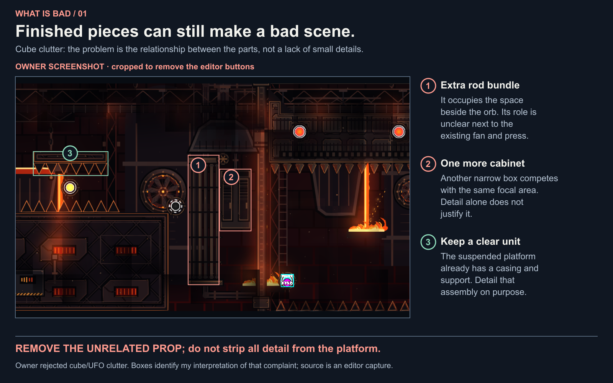

**Your feedback, paraphrased:** Objects in cube/UFO make no sense; there are too many things for no reason.

**My lesson:** The rod bundle and adjacent cabinet crowd an already established scene. Retain the coherent platform and improve its surfaces.

### 02 · Decoration stopped before the level did.

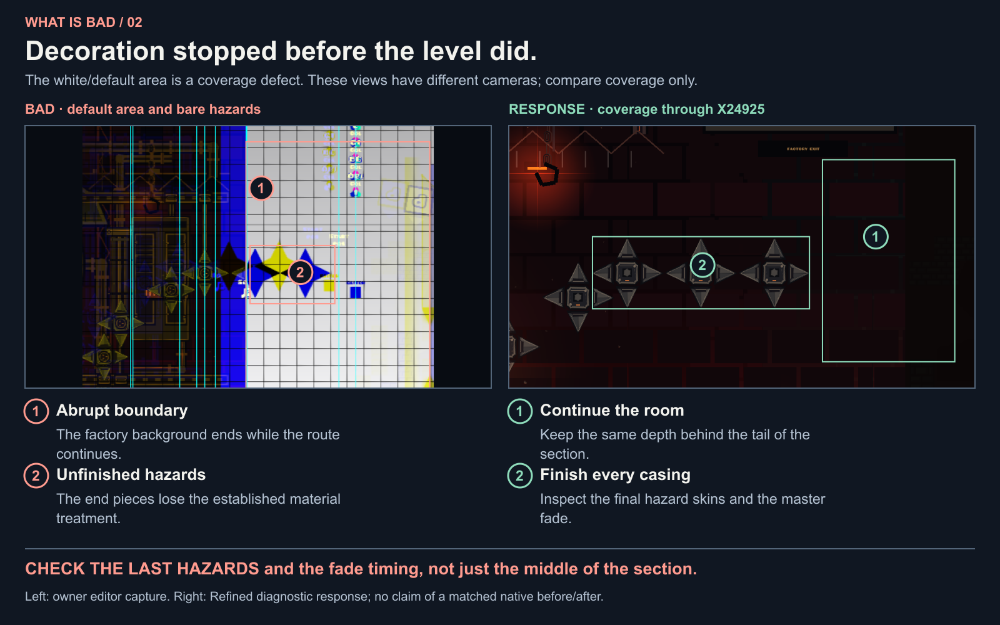

**Your feedback, paraphrased:** There is a white part that was not decorated.

**My lesson:** Cover the final hazards and delay the factory fade. A nice central frame cannot prove that the complete section is finished.

## What is good

### 03 · The ship feels like one built environment.

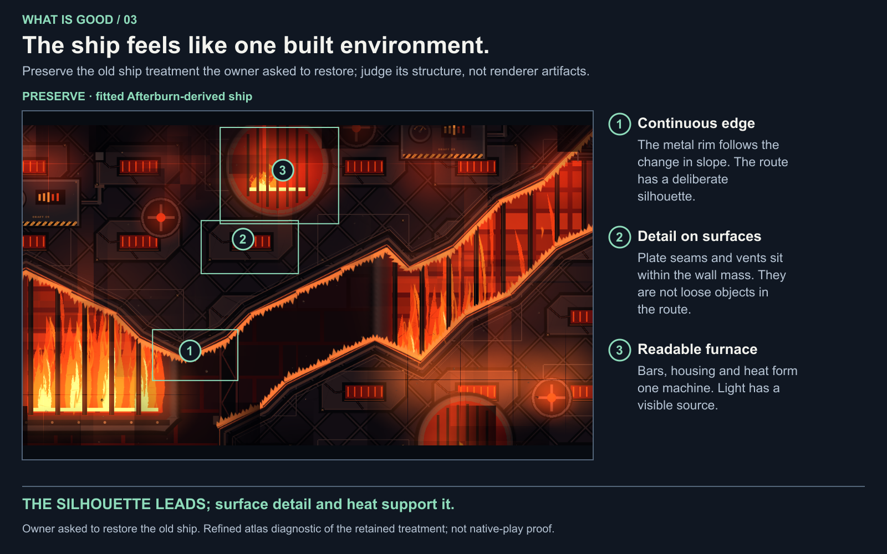

**Your feedback, paraphrased:** I liked the ship, so change that back to the old one.

**My lesson:** Continuous fitted edges, panel detail inside the walls and recognizable furnace openings give the route a coherent setting.

### 04 · Keep the parts with a recognizable identity.

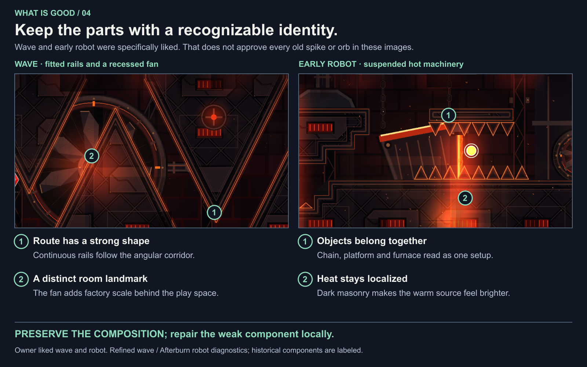

**Your feedback, paraphrased:** I really like the wave and the robot part, but the rest is still pretty bad.

**My lesson:** Retain their structural idea, dark depth and localized heat. Later custom spike/orb work can improve components without replacing the scene.

## Bad techniques

### 05 · Do not answer “too basic” by filling the air.

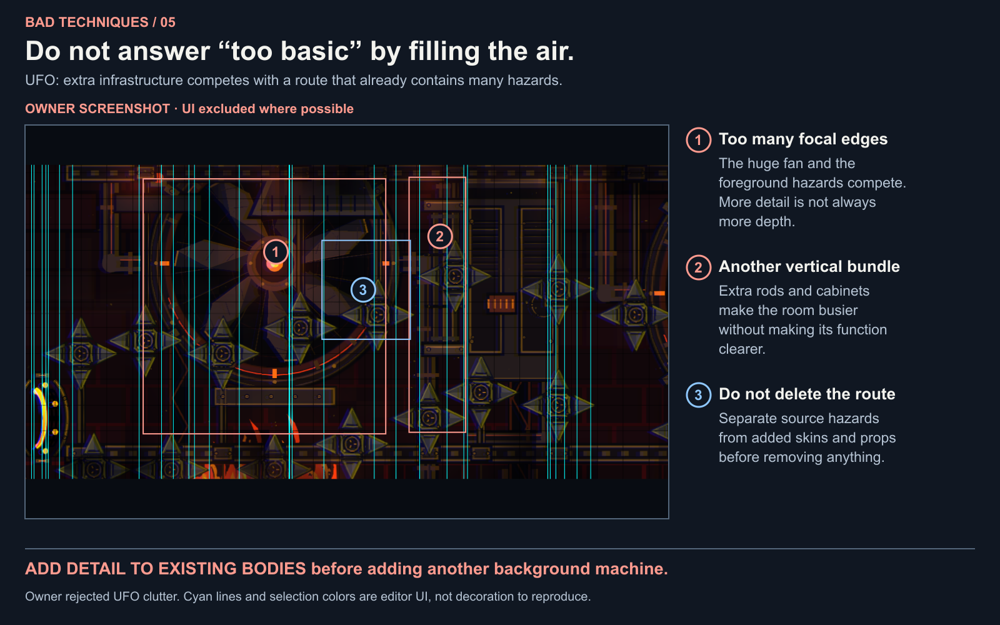

**Your feedback, paraphrased:** The cube/UFO are too crowded and many objects appear to have no reason.

**My lesson:** Classify gameplay hazards, their skins and background machinery separately. Remove redundant decoration, not source gameplay.

### 06 · More screen coverage did not make better fire.

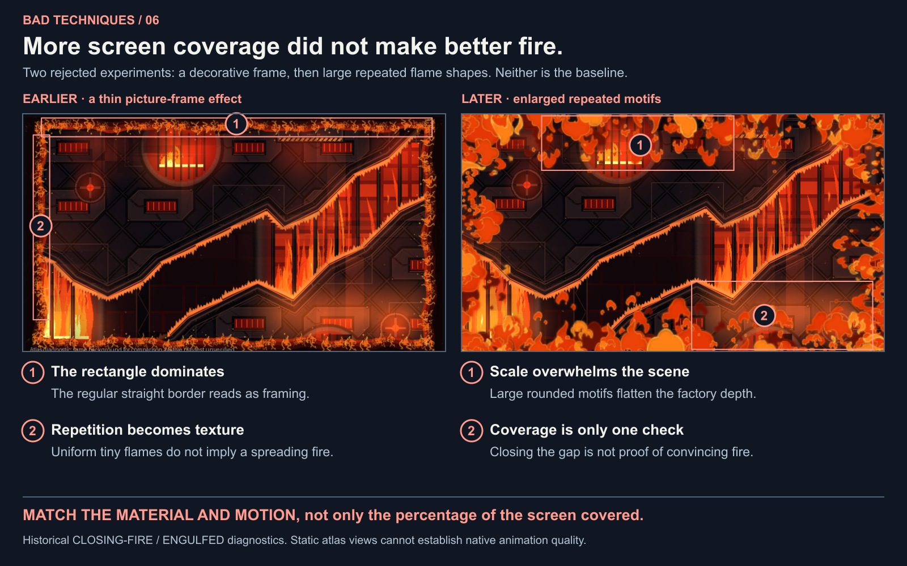

**Your feedback, paraphrased:** The fire should close in and eventually engulf the player, but these results looked poor; the first was preferred over the later version.

**My lesson:** A mechanical coverage target missed scale, repetition, color and integration. Repeated oversized flames look pasted on the scene.

## Good techniques

### 07 · Turn an outline into a fitted material.

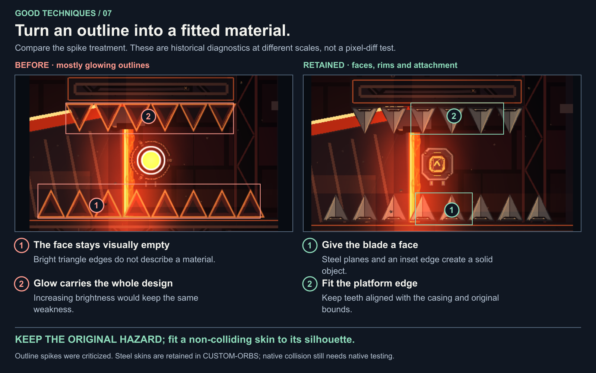

**Your feedback, paraphrased:** The spikes are not decorated; the spike and block designs are too basic.

**My lesson:** Use a dark steel face, inset edge, restrained bevel and mounting seam. Do not enlarge the invisible hazard to match new art.

### 08 · Custom art should preserve the interaction.

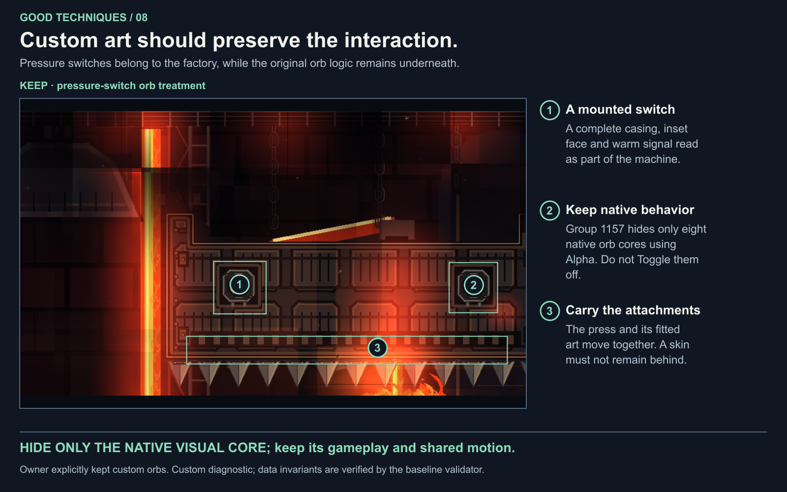

**Your feedback, paraphrased:** Keep custom orbs but undo the custom portals.

**My lesson:** Keep the pressure-switch casing attached to its parent. Separate visual alpha from toggling gameplay; retain native portal appearance.

## What I learned

### 09 · A rollback can apply to just one component.

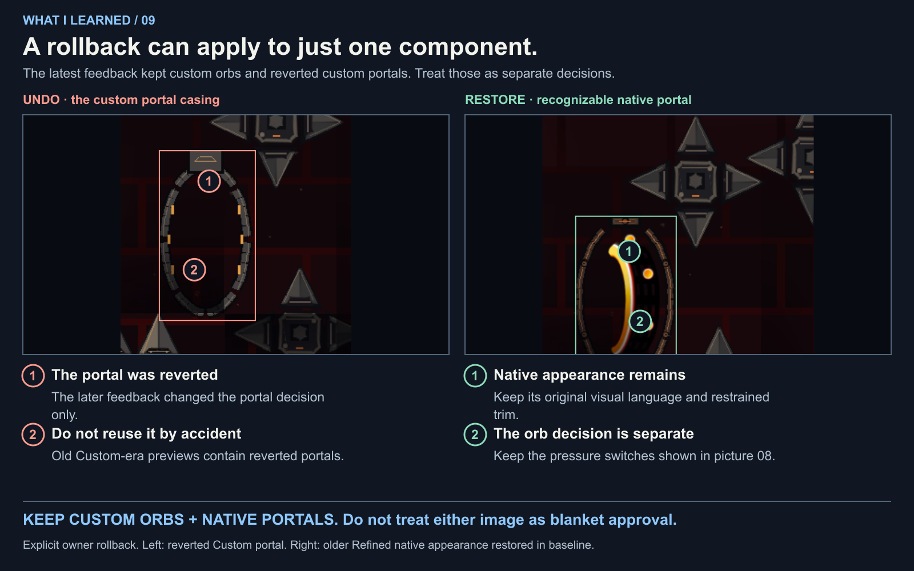

**Your feedback, paraphrased:** Okay, keep custom orbs but undo the custom portals.

**My lesson:** Track the latest decision for each component. The owner originally requested custom portals, then reverted them while keeping custom orbs; do not label an entire revision approved or rejected.

You originally asked for custom portals too, then asked to undo them. The lesson is to follow that later, specific decision—not to claim you never requested them.

### 10 · Good-looking art can still break the level.

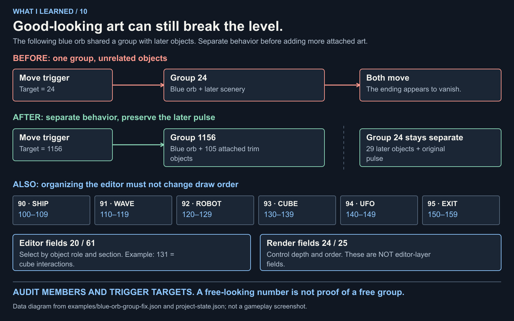

**Your feedback, paraphrased:** Later objects seemed to disappear; the blue following orb was moving objects with the same group ID. Organize the build into editor layers.

**My lesson:** The fix must isolate the moving assembly, preserve the later pulse, and distinguish editor organization from render depth.

The diagram uses [real before/after objects](../examples/blue-orb-group-fix.json) and [editor-layer records](../examples/editor-layers.json). The data fix is checked; native gameplay has not been certified.

## Things for later

### 11 · Prototype one purposeful assembly first.

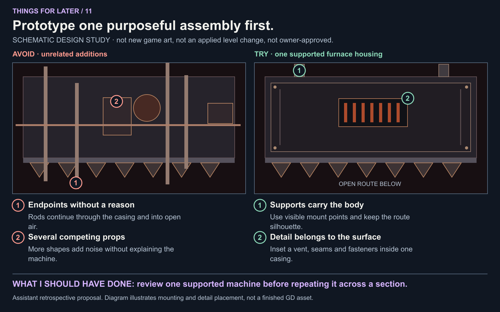

**My proposed next step:** Instead of responding with a large prop pass, first test one coherent casing with support, bounded detail and preserved negative space.

**How to judge it:** At gameplay scale, identify the machine function and supports without explaining every prop. Preserve original collision and empty route.

### 12 · Test atmosphere as a sequence, not a still.

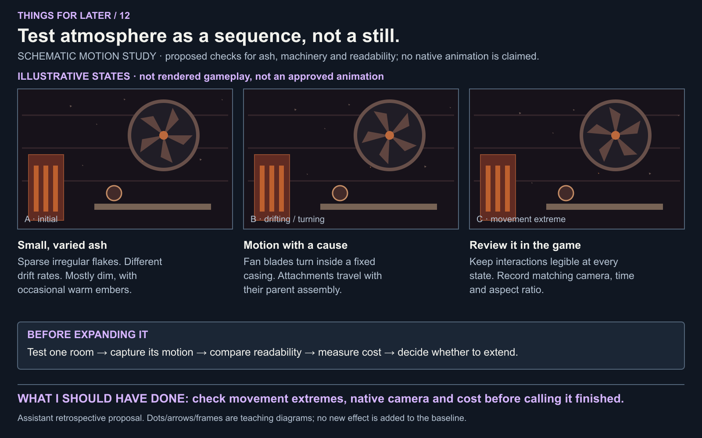

**Your feedback, paraphrased:** The atmosphere should be darker with more realistic burning ashes; decoration should include moving elements.

**My proposed next step:** Start with small dim irregular flakes and motion attached to believable machinery. Test several moments and measure performance before scaling up.

**How to judge it:** Capture actual game states with camera/time/aspect recorded; inspect interactions, moving attachments, exit coverage and performance.

## Use this with Opus

Ask Opus to open the relevant pictures, then identify the numbered feature,
the owner feedback it responds to, and the component that must stay. A useful
critique should point to a visible cause, not say "make it better" or prescribe
more objects. Use the [visual review questions](../examples/visual-review-questions.md)
to check whether the model understood the pictures before a new design pass.

For the original unmarked images and revision context, open
[visual sources](VISUAL_SOURCES.md). The [visual manifest](visual-guide.json)
contains every source path, checksum, crop rectangle, annotation, evidence label,
feedback paraphrase and lesson in machine-readable form. These are repository
context examples; no training job has been run.

The [maintenance notes](VISUAL_GUIDE_MAINTENANCE.md) explain how to add a new
case and regenerate the figures. Keep new proposals separate from accepted work.
