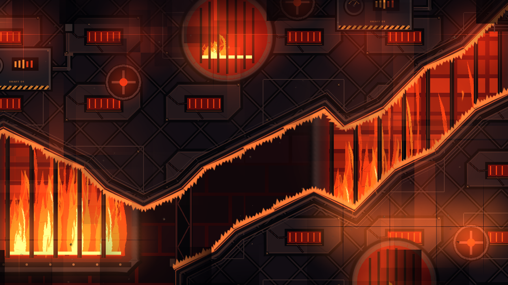
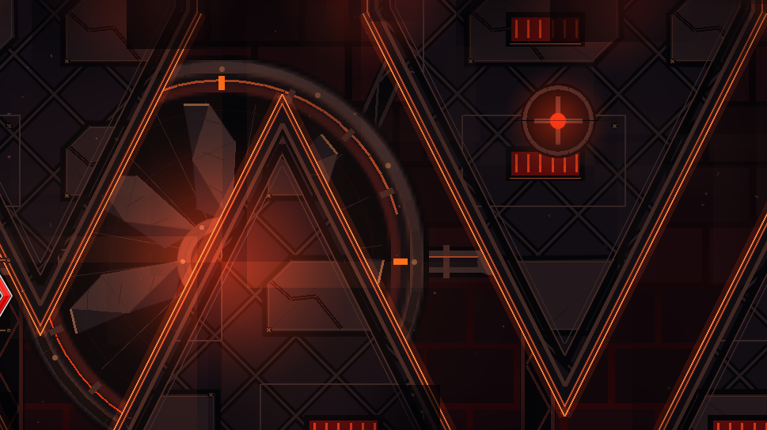
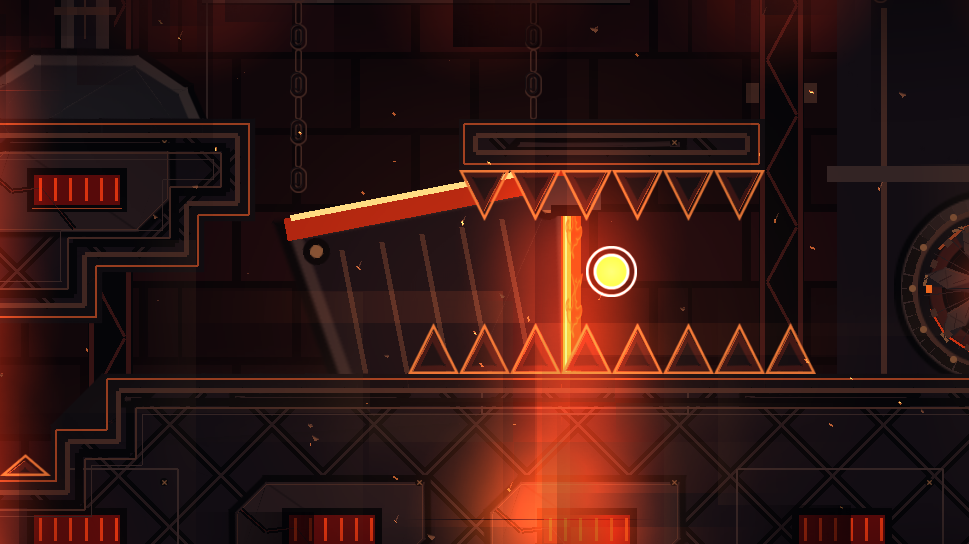
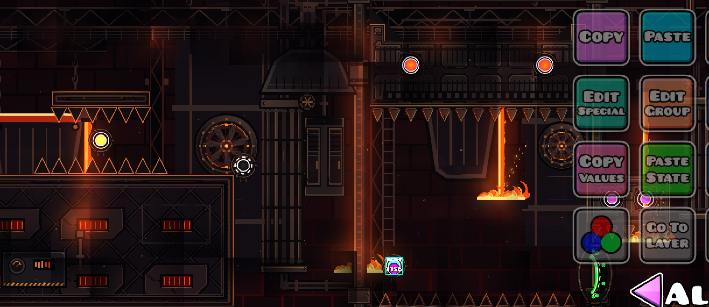
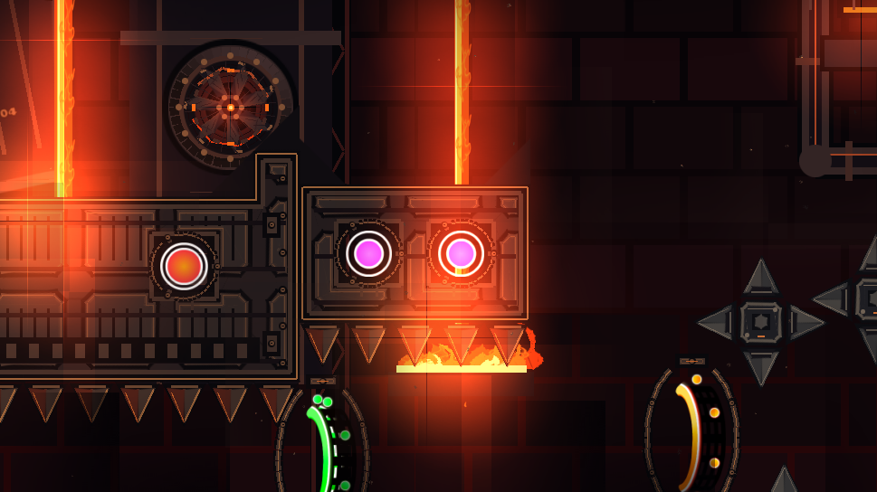
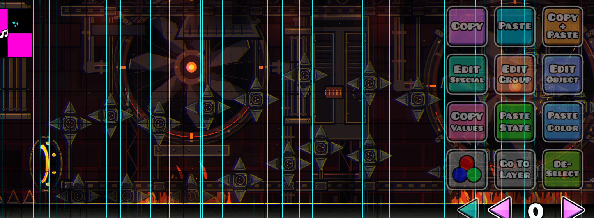
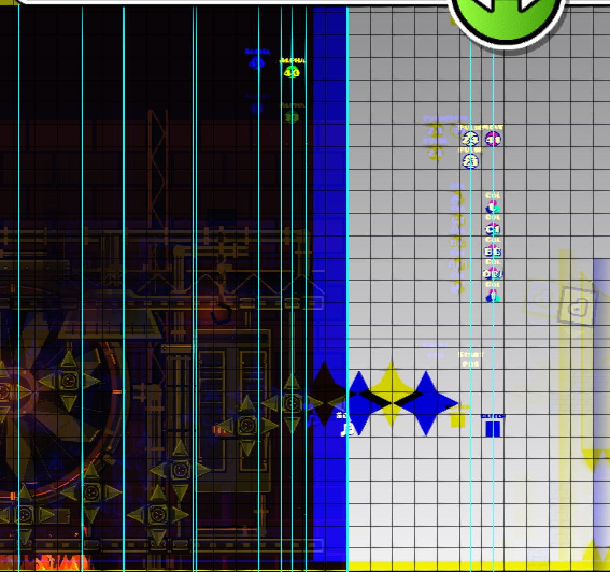
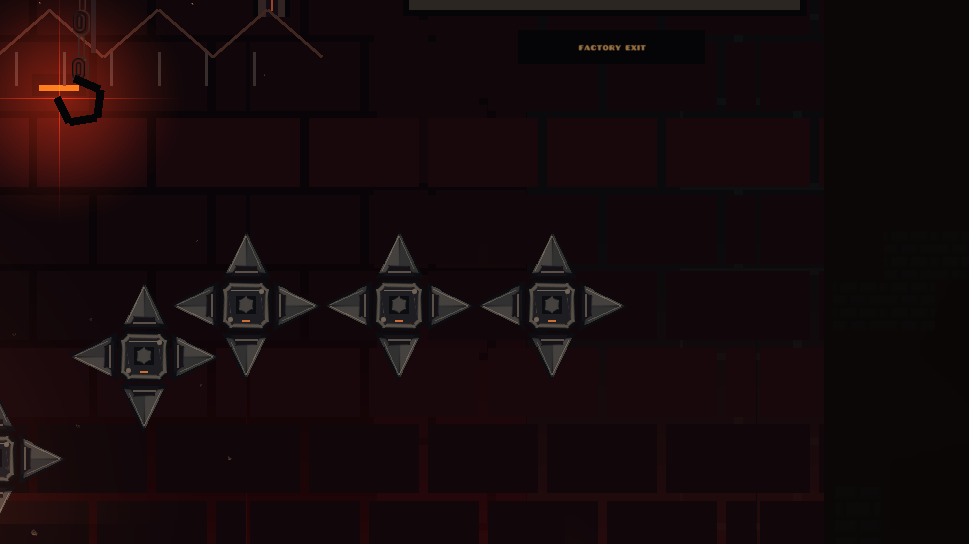
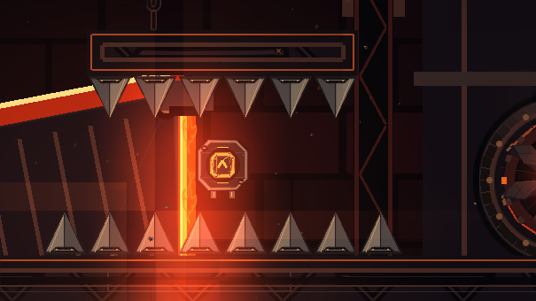
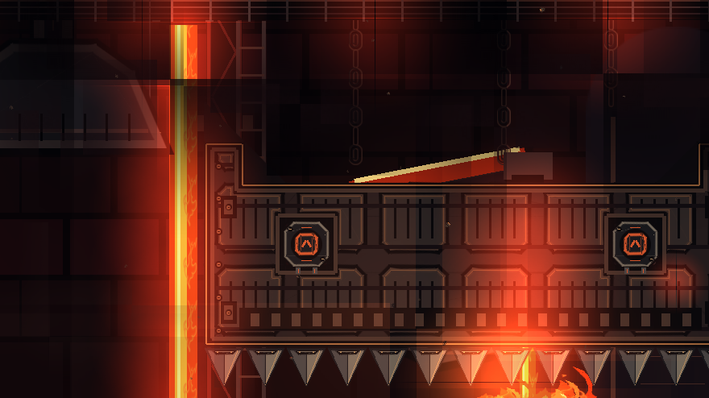

# Original visual sources

For numbered annotations and the six teaching categories, start with the
[illustrated guide](VISUAL_EXAMPLES.md). These are the unannotated source views.
Each caption states its revision and what is being judged.
The whole image is not automatically approved just because one component is.

## Preserve: fitted ship structure

**Evidence:** owner asked for the old ship to be restored. This is a diagnostic
render of the retained treatment in Refined, not a new native screenshot.
Observe how the sloped corridor has continuous fitted metal edging, panels stay
inside its masses, furnace bars have a destination, and the empty route remains
a strong silhouette. The exact data is retained in CUSTOM-ORBS. Do not infer that
the old preview renderer's fire fill or lighting is a pixel-perfect game result.

## Preserve: wave and early robot identity

**Evidence:** the owner explicitly liked the wave and robot before subsequent
detail passes. Preserve their silhouettes and recognizable industrial setups.
Compare fittings and background depth, not just orange color or object quantity.
The data validator protects the retained skin objects across later revisions.

## Negative: cube details without a clear purpose

**Evidence:** the owner said objects started making no sense around cube/UFO and
there were too many things for no reason. Look at the tall narrow rod bundle and
additional rectangular assembly between existing machinery: even individually
finished pieces can compete with the scene's structure and orb route. Do not use
this screenshot as an approved density target. Refined removed additive cabinets,
pipe bundles, press guides and old hairline hangers.

**Interpretation:** retain purposeful surface detail while reducing unrelated
free-standing props. This image documents the response, not final user approval.

## Negative: UFO field needs an organized hierarchy

The owner objected to the amount of unrelated detail. Distinguish source hazards
from their added skins and from background machinery before removing anything.
The cyan vertical lines and selection outlines are editor UI, not decorations to
copy. Keep floating hazard housings complete, but avoid surrounding every one
with a new set of rails, rods and large props.

## Regression: unfinished white exit

This shows the old decoration ending too early. The white/default region and
unskinned hazards are a coverage defect, not an intended bright scene transition.
The baseline extends coverage through X24925 and delays the factory fade beyond
the last hazards. Check both geometry coverage and runtime alpha timing.

## Custom spikes and orbs: inspect components separately

The complaint was that outlined triangles were still undecorated. The replacement
adds steel faces and inset detail while preserving the original hazard geometry.
This component is retained in CUSTOM-ORBS; it does not authorize custom portals.

The owner explicitly kept custom orbs, then undid custom portals. This earlier
Custom screenshot demonstrates the orb treatment only. Any portal treatment
visible in a Custom-era image is superseded by the native portal rollback.

## Rejected border experiments

[CLOSING-FIRE comparison](../outputs/The%20Sinking%20Factory%20-%20CLOSING-FIRE-preview.png)
and [ENGULFED preview](../outputs/The%20Sinking%20Factory%20-%20ENGULFED-preview.png)
remain as **negative/historical references**. Feedback: the border should close
in and engulf the player, but these results looked poor and the earlier one was
preferred over a later attempt. The subsequent custom-art experiment has been
excluded at the user's request. None of these are the current baseline.

## Comparing a new change

Use the same camera, zoom, aspect ratio and trigger time for before/after views.
Show the changed assembly, a full gameplay frame and a movement extreme. Label
whether each is native or approximate. Record a specific defect and the response
in [feedback examples](../examples/feedback-cases.jsonl); do not label an unreviewed
render “approved.” The raw source screenshots here contain game/editor content
only; private chat screenshots are not published.
